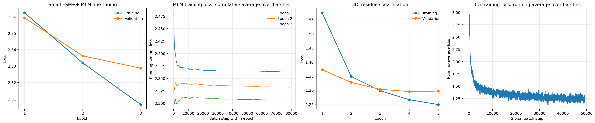

# MLM and residue-classification training report

> **Caveat (found during the repository cleanup).** The legacy `esmretrain.py` did not
> actually copy the MLM checkpoint's weights into the backbone: the 3Di run below
> was trained on the stock `Synthyra/ESMplusplus_small` backbone (verified by
> comparing `checkpoints/esm3di_from_mlm/*.pt` against both the base model and
> the MLM checkpoint). The 3Di numbers therefore measure "base ESM++ + LoRA + CNN
> head", not the MLM → 3Di recipe. The new `esm3di train --init-from <mlm dir>`
> transfers the backbone and reports the number of tensors copied; rerun with it
> to measure the effect of the MLM stage.

## Scope

This report covers the small ESM++ model selected for use:

1. MLM fine-tuning recorded in `esmc_viral_ft/train.log` (training run directory, not tracked in git), ending at `esmc_viral_ft/epoch_3/`.
2. Five-epoch 3Di per-residue classification recorded in `tensorboard_logs/esm3di_from_mlm/run_20260326_212108/`, initialized from that MLM epoch-3 checkpoint.

The figure and tables are reproducible with [`mlm-and-residue-loss-curves.ipynb`](../analyses/scratch/output/jupyter-notebook/mlm-and-residue-loss-curves.ipynb).

## Loss histories

| Task | Epoch | Training loss | Validation loss |
| --- | ---: | ---: | ---: |
| MLM | 1 | 2.362477 | 2.359371 |
| MLM | 2 | 2.331953 | 2.336219 |
| MLM | 3 | 2.306546 | 2.328680 |
| 3Di residue classification | 1 | 1.574463 | 1.372658 |
| 3Di residue classification | 2 | 1.348761 | 1.327600 |
| 3Di residue classification | 3 | 1.298178 | 1.303134 |
| 3Di residue classification | 4 | 1.266426 | 1.295301 |
| 3Di residue classification | 5 | 1.249222 | 1.296983 |

MLM validation loss decreased by 0.031 across its three recorded epochs. Its log also contains 2,370 cumulative running-average training losses (790 per epoch), recorded every 100 batches; because this average resets each epoch, the figure plots its three trajectories separately. The classifier reached its lowest validation loss at epoch 4 (1.295301); epoch 5 reduced training loss further but validation loss was effectively flat/slightly higher. The fourth panel adds the classifier's recorded `Loss/train_running_avg` scalar over 4,939 logged batch updates, making the within-run training convergence visible. Both batch-level traces are smoothed training signals rather than validation curves. Loss magnitudes are not comparable across tasks because their objectives and output spaces differ.

## Dataset

Both stages use the BFVD “nomasking” split directory: `/mnt/data1/bfvd/training_set_nomasking/splits/`.

| Split | Sequences | Files |
| --- | ---: | --- |
| Train | 316,117 | `bfvd_train_aa.fasta`, `bfvd_train_3di.fasta`, `bfvd_train_plddt_bins.fasta` |
| Validation | 1,756 | `bfvd_val_aa.fasta`, `bfvd_val_3di.fasta`, `bfvd_val_plddt_bins.fasta` |
| Test | 33,369 | `bfvd_test_aa.fasta`, `bfvd_test_3di.fasta`, `bfvd_test_plddt_bins.fasta` |

The MLM stage consumes the amino-acid sequences and applies a masked-token objective. The residue-classification stage consumes matched amino-acid and unmasked 3Di sequences (same sequence order and residue length); the pLDDT-bin FASTA files provide confidence-aware weighting and stratified measurements. The selected classifier configuration explicitly supplies train and validation files; the test split is the dataset’s held-out split and is not part of its five-epoch validation curve.

## Runs and configuration

### Small ESM++ MLM fine-tuning

- Base architecture: `Synthyra/ESMplusplus_small` — 30 transformer layers, hidden size 960, 15 attention heads, and a 33-token vocabulary (from `esmc_viral_ft/epoch_3/config.json`).
- Recorded run: 3 epochs, with epoch summaries and final test loss in `esmc_viral_ft/train.log`.
- Result: epoch-3 checkpoint (`esmc_viral_ft/epoch_3/`) was used as the initialization checkpoint for the selected residue classifier.

The historical log does not preserve a full CLI/config snapshot for this MLM run, so this report limits hyperparameter claims to the values recorded in artifacts and source code.

### 3Di residue classifier

The run is specified in `configs/config_mlm_resume_3di.json` (its settings are now in [`configs/3di_esmpp_small_from_mlm.json`](../../configs/3di_esmpp_small_from_mlm.json)) and saves to `checkpoints/esm3di_from_mlm`.

- Initialization: `./esmc_viral_ft/epoch_3/` MLM checkpoint.
- Objective: per-residue 3Di token classification from amino-acid sequences.
- Epochs: 5; batch size: 4; gradient accumulation: 8.
- Optimizer: AdamW, learning rate `1e-4`, weight decay `0.01`.
- Schedule: cosine, with warmup ratio `0.1`.
- Head: 2-layer CNN, kernel size 3, dropout `0.1`.
- Adaptation: LoRA `r=16`, alpha `32`, dropout `0.01`; mixed precision enabled.
- pLDDT prediction head: disabled; pLDDT bins remain available for weighting/stratified metrics.

## Reproduction notes

The notebook reads MLM epoch summaries plus its batch-level cumulative averages from the text log and extracts the classifier’s epoch-level scalar series (`Loss/train_epoch` and `Loss/val_epoch`) plus `Loss/train_running_avg` from the TensorBoard event stream. It saves the figure to `reports/assets/training_validation_loss_curves.png`.
